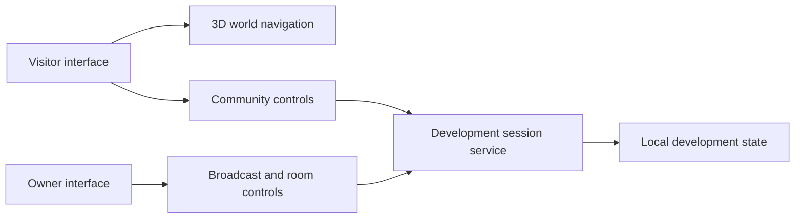

# Engineering case study — NOVALENTI WORLD

## Product objective

Develop a branded, interactive audiovisual world that bridges music production, live broadcasting, and community participation. The private prototype focuses on proving specific interactions before attempting a public launch.

## Architecture at a high level

This conceptual view intentionally omits endpoints, tokens, source modules, private infrastructure, authentication implementation details, and deployment identifiers.

## Engineering decisions

1. **Stage the product behind separate interfaces.** Visitor experiences and broadcaster controls have different permissions and risks.
2. **Keep imported media local.** The Club prototype's audio import is for the creator's local rehearsal files, not a music-hosting service.
3. **Test isolated rules before integration.** Garden-growth timing and remix eligibility rules were explored independently, without claiming any payment or NFT integration.
4. **Document prototype limitations.** Cookie-only voting is not a strong identity system; simple JSON persistence is unsuitable for scaled concurrent workloads.
5. **Preserve original IP.** Source code, business logic, private audio, infrastructure configurations, and nonpublic assets stay private.

## Verification and limitations

A historical project handoff described local builds, test runs, and route smoke checks in October 2026. This public case study does not independently certify production readiness or a live deployment. All future public-launch claims need fresh evidence.

## Next engineering gates

- Formal user authentication and abuse resistance
- Persistent database and backups
- Public-host security review and monitoring
- Cross-browser/mobile acceptance testing
- Rights clearance for art, audio, and animation assets
- Deployment, rollback, and uptime verification

## Business and rights

Access to nonpublic source, paid deployments, adaptations, work-for-hire, and commercial use requires a separately agreed written scope and license. A public showcase alone creates no automatic royalty or payment obligation.
